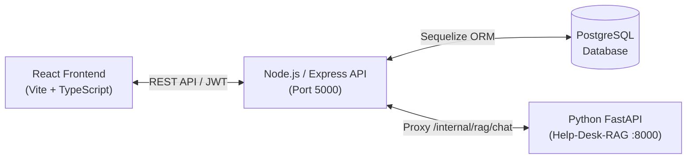

# HelpDesk FullStack 🎫⚡

> Complete Help Desk ticketing, agent appointment scheduling, and AI-powered knowledge assistant platform built with the PERN stack (PostgreSQL, Express, React, Node.js).

[](https://help-desk-reactpg.vercel.app)
[](https://github.com/Akshithreddy89/Help-Desk)
[](https://github.com/Akshithreddy89/Help-Desk-RAG)

---

## 📌 Overview

**HelpDesk** is an enterprise-grade customer support and scheduling system. It streamlines customer ticket creation, enables real-time agent ticket management via Kanban boards, provides interactive appointment booking, and features an integrated **RAG (Retrieval-Augmented Generation) AI assistant** for instant customer troubleshooting.

---

## 🏗️ Architecture



---

## ✨ Features by Role

- 👤 **Customers:**
  - Create support tickets and track real-time resolution status.
  - Interactive **AI Chatbot** for instant Q&A powered by the [Help-Desk-RAG](https://github.com/Akshithreddy89/Help-Desk-RAG) service.
  - Book scheduled meeting slots with support agents.

- 👨‍💼 **Support Agents:**
  - Visual drag-and-drop **Kanban board** to manage ticket lifecycle (Open, In Progress, Resolved).
  - Configure daily availability slots and view booked customer meetings on a calendar.

- 🛡️ **Administrators:**
  - System-wide dashboard with ticket analytics and performance metrics.
  - Manage users and send email invitations to new support agents.

---

## 🛠️ Tech Stack

| Layer | Technologies |
|---|---|
| **Frontend** | React, TypeScript, Vite, Material UI, Axios |
| **Backend** | Node.js, Express.js, Sequelize ORM |
| **Database** | PostgreSQL |
| **Authentication** | JWT (JSON Web Tokens), Role-Based Access Control (RBAC) |
| **AI / RAG Service** | Python, FastAPI, Google Gemini, pgvector ([Help-Desk-RAG](https://github.com/Akshithreddy89/Help-Desk-RAG)) |
| **Email Service** | Resend API |

---

## 🚀 Getting Started

### 1. Prerequisites
- [Node.js](https://nodejs.org/) (v18+ recommended)
- [PostgreSQL](https://www.postgresql.org/) database running locally or on cloud (e.g., Supabase / Neon)
- *(Optional)* [Help-Desk-RAG](https://github.com/Akshithreddy89/Help-Desk-RAG) running on `http://127.0.0.1:8000` for AI chatbot support

---

### 2. Backend Setup (`helpdesk-bd`)

```bash
cd helpdesk-bd
npm install

# Configure environment variables
cp .env.example .env
# Update .env with your PostgreSQL credentials and JWT secret

# Run migrations and seed sample data
npm run migrate
npm run seed

# Start development server (Port 5000)
npm run dev
```

---

### 3. Frontend Setup (`helpdesk-fd`)

In a new terminal window:

```bash
cd helpdesk-fd/frontend
npm install

# Start Vite development server (Port 5173)
npm run dev
```

Open `http://localhost:5173` in your browser.

---

## 🔐 Default Test Credentials

Use these seeded accounts to log in directly:

| Role | Email | Password |
|---|---|---|
| **Admin** | `admin1@helpdesk.com` | `12345` |
| **Agent** | `macha.akshith@gmail.com` | `sai@12345` |
| **Customer** | `uday@gmail.com` | `uday@12345` |

---

## 🔗 Related Repositories

- 🤖 **[Help-Desk-RAG](https://github.com/Akshithreddy89/Help-Desk-RAG)**: The Python FastAPI microservice providing vector embeddings and knowledge base retrieval for the AI assistant.

---

## 👤 Author

- **Akshith Reddy** - [@Akshithreddy89](https://github.com/Akshithreddy89)
